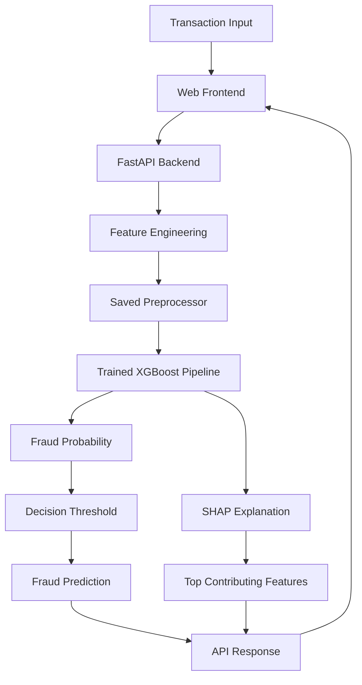

# Bank Fraud Detection System

An end-to-end machine learning application that predicts potentially fraudulent bank transactions using **XGBoost**, handles class imbalance with **SMOTE**, and explains individual predictions using **SHAP**. The project includes a FastAPI backend, an interactive web frontend, model evaluation visualizations, and a configurable fraud-detection threshold.

## Project Overview

Bank fraud detection is challenging because fraudulent transactions typically represent only a small fraction of all transactions. A model that predicts every transaction as legitimate could achieve high accuracy while failing to identify actual fraud.

This project addresses that challenge by combining machine learning, imbalanced-data handling, threshold optimization, and explainable AI.

The system accepts transaction details, estimates the probability of fraud, classifies the transaction using a configurable decision threshold, and identifies the features that contribute most to the prediction.

## Key Features

- **Fraud probability prediction:** Estimates the likelihood that a transaction is fraudulent.
- **XGBoost classification:** Uses a gradient-boosted tree model for fraud detection.
- **SMOTE:** Addresses class imbalance during model training.
- **Optuna hyperparameter tuning:** Searches for model and sampling parameters using stratified cross-validation.
- **Decision-threshold optimization:** Targets fraud recall of at least 80% while keeping the false-positive rate at or below 5%.
- **SHAP explainability:** Identifies the strongest contributors to individual fraud predictions and calculates global feature importance.
- **Interactive web interface:** Provides a frontend for submitting transaction details and viewing predictions.
- **FastAPI backend:** Exposes prediction and health-check endpoints.
- **Evaluation visualizations:** Includes a confusion matrix, ROC curve, SHAP feature importance, and exploratory data analysis plots.

> The recall and false-positive-rate values above are optimization targets, not guaranteed results. Actual performance is recorded in `models/metadata.json`.

## Tech Stack

| Component | Technologies |
|---|---|
| Language | Python |
| Data processing | Pandas, NumPy, SciPy |
| Machine learning | Scikit-learn, XGBoost |
| Imbalanced data | imbalanced-learn, SMOTE |
| Hyperparameter tuning | Optuna |
| Explainable AI | SHAP |
| Data visualization | Matplotlib, Seaborn |
| Backend API | FastAPI, Uvicorn, Pydantic |
| Model persistence | Joblib |
| Frontend | HTML5, CSS3, JavaScript |

## System Architecture



### How It Works

1. The user enters transaction details through the web interface.
2. The frontend sends the transaction to the FastAPI prediction endpoint.
3. The backend derives time-based features from the transaction timestamp.
4. The saved preprocessor encodes categorical variables and prepares the input.
5. The trained XGBoost pipeline calculates the fraud probability.
6. The probability is compared with the selected threshold to determine the fraud flag.
7. SHAP identifies the top contributing features for that transaction.
8. The API returns the probability, fraud flag, threshold, and explanations.

## Project Structure

```text
Project1_Bank_Fraud_Detection/
│
├── app/
│   ├── __init__.py
│   └── main.py
│
├── data/
│   └── transactions.csv
│
├── frontend/
│   ├── index.html
│   ├── script.js
│   └── style.css
│
├── models/
│   ├── metadata.json
│   ├── preprocessor.joblib
│   └── xgb_pipeline.joblib
│
├── outputs/
│   ├── amount_distribution.png
│   ├── class_imbalance.png
│   ├── confusion_matrix.png
│   ├── correlation_heatmap.png
│   ├── roc_curve.png
│   └── shap_global_importance.png
│
├── scripts/
│   ├── eda.py
│   ├── generate_data.py
│   └── train.py
│
├── src/
│   ├── __init__.py
│   ├── data_prep.py
│   └── model.py
│
├── Bank_Fraud_Detection_Rec.mp4
├── requirements.txt
├── .gitignore
└── README.md
```

## Installation and Setup

### Prerequisites

- Python 3.10 or a compatible version supported by the listed dependencies
- Git
- pip

### 1. Clone the repository

```bash
git clone YOUR_GITHUB_REPOSITORY_URL
cd Project1_Bank_Fraud_Detection
```

Replace `YOUR_GITHUB_REPOSITORY_URL` with the actual repository URL. Adjust the directory name if your cloned folder has a different name.

### 2. Create a virtual environment

**Windows PowerShell:**

```powershell
python -m venv .venv
.\.venv\Scripts\Activate.ps1
```

If PowerShell blocks activation, you can use the appropriate execution policy for your environment or activate the environment through your IDE.

### 3. Install dependencies

```bash
python -m pip install --upgrade pip
pip install -r requirements.txt
```

### 4. Verify model artifacts

The API loads the saved preprocessing and model artifacts during startup. Ensure these files exist:

```text
models/preprocessor.joblib
models/xgb_pipeline.joblib
models/metadata.json
```

If they are missing, train the model using the next step.

### 5. Train the model (if required)

Run this command from the project root:

```bash
python scripts/train.py
```

The training pipeline performs feature engineering, preprocessing, baseline training, Optuna-based XGBoost tuning, evaluation, threshold optimization, SHAP analysis, visualization generation, and model-artifact saving.

**Note:** Training can take time because hyperparameter tuning uses 30 Optuna trials with three-fold stratified cross-validation. Existing model artifacts may be overwritten.

## Run the Application

Start the FastAPI server from the project root:

```bash
python -m uvicorn app.main:app --reload --port 8000
```

Open the following URLs:

| URL | Purpose |
|---|---|
| `http://127.0.0.1:8000/` | Web frontend |
| `http://127.0.0.1:8000/docs` | Interactive API documentation |
| `http://127.0.0.1:8000/health` | API and model health status |

The frontend is mounted by FastAPI when the `frontend` directory exists.

### Health Check

Send a GET request to `/health`. The response reports the API status, whether the model artifacts loaded successfully, the configured threshold, and the training timestamp when available.

## 🔌 API Documentation

### `POST /predict`

Accepts transaction details and returns the predicted fraud probability, fraud flag, threshold used, and top contributing features.

#### Example request

```json
{
  "amount": 4500.00,
  "timestamp": "2025-07-15T02:30:00",
  "transaction_type": "WIRE_TRANSFER",
  "merchant_category": "cash_advance",
  "country": "NG",
  "device_risk_score": 0.82,
  "ip_risk_score": 0.77
}
```

The categorical values must belong to the allowed lists defined in `src/data_prep.py`. The timestamp must be a valid datetime string, and the amount must be greater than zero. Device and IP risk scores must be between 0 and 1.

#### Example response structure

```json
{
  "fraud_probability": 0.91,
  "fraud_flag": true,
  "threshold_used": 0.5,
  "top_contributing_features": [
    {
      "feature": "device_risk_score",
      "value": 0.82,
      "shap_value": 0.31,
      "direction": "increases_fraud_risk"
    }
  ]
}
```

**Illustrative response only:** the probability, threshold, feature names, and SHAP values above are examples, not measured output from the trained model. The real response may contain up to five contributing features.

## Machine Learning Workflow

### 1. Data preparation and feature engineering

The system uses `data/transactions.csv` and derives additional features from each transaction's timestamp:

- `hour`: hour of the transaction.
- `day_of_week`: day of the week represented numerically.
- `is_night`: indicator for transactions occurring between midnight and 5 AM, inclusive.

The data is split into training and testing sets using stratification to preserve the fraud-class proportion.

### 2. Preprocessing

A Scikit-learn `ColumnTransformer` handles categorical and numerical features.

- Categorical features are one-hot encoded.
- Numerical features pass through without scaling.
- Unknown categorical values are handled by the encoder without causing inference to fail.

The same saved preprocessor is used during inference to keep the feature transformation consistent.

### 3. Baseline model

A Logistic Regression classifier with SMOTE provides a baseline for comparison.

### 4. XGBoost and hyperparameter tuning

Optuna searches XGBoost hyperparameters and the SMOTE sampling strategy using stratified cross-validation. The tuning objective is recall at a false-positive-rate cap of 5%, aligning model selection with the intended fraud-detection operating point.

### 5. Threshold optimization

Instead of relying exclusively on the default 0.5 threshold, the training workflow searches a range of thresholds to find a suitable balance between catching fraud and avoiding false alarms.

The configured targets are:

- Minimum fraud recall: 80%.
- Maximum false-positive rate: 5%.

If no threshold meets both constraints, the implementation falls back to the best available recall under the false-positive-rate cap when possible. The actual outcome is recorded in the metadata.

### 6. Explainable AI with SHAP

SHAP is used to explain model predictions at two levels:

- **Global explanation:** ranks features by their mean absolute SHAP values across a sample of test transactions.
- **Local explanation:** identifies the strongest feature contributions for an individual transaction.

Positive SHAP contributions push the prediction toward fraud, while negative contributions push it toward a legitimate transaction.

## Model Evaluation

The training script evaluates the baseline and XGBoost models using:

| Metric | What it measures |
|---|---|
| Recall | Proportion of actual fraudulent transactions correctly identified |
| Precision | Proportion of transactions flagged as fraud that are actually fraudulent |
| False-positive rate | Proportion of legitimate transactions incorrectly flagged |
| ROC-AUC | Ability to distinguish fraud from legitimate transactions across thresholds |
| PR-AUC | Precision-recall performance, particularly useful for imbalanced data |
| Confusion matrix | Counts of true positives, false positives, true negatives, and false negatives |

The project stores baseline metrics, default-threshold XGBoost metrics, optimized-threshold metrics, threshold settings, and SHAP importance data in `models/metadata.json`.

To inspect the recorded results:

```powershell
Get-Content models/metadata.json
```

Only report the values recorded in that file as the model's actual results. In particular, check `targets_met` before claiming that the configured recall and false-positive-rate targets were achieved.

## Visualizations

The `outputs/` directory contains the following generated visualizations:

| File | Purpose |
|---|---|
| `amount_distribution.png` | Explores the distribution of transaction amounts |
| `class_imbalance.png` | Shows the distribution of legitimate and fraudulent transactions |
| `correlation_heatmap.png` | Examines relationships between numerical features |
| `confusion_matrix.png` | Shows classification outcomes at the optimized threshold |
| `roc_curve.png` | Visualizes the ROC curve for the XGBoost model |
| `shap_global_importance.png` | Ranks features by global SHAP importance |

These plots help examine data patterns, evaluate classification behavior, and understand the model's decisions.

## Project Demo

Watch the recorded application demonstration:

[View Bank Fraud Detection Demo](./Bank_Fraud_Detection_Rec.mp4)

The video is included in the repository. If GitHub cannot preview it directly, download the video or open it locally.

## Limitations and Responsible Use

- This project is an educational machine learning prototype, not a production banking security system.
- Prediction quality depends on the representativeness and quality of the training data.
- Fraud predictions are probabilistic and can produce both false positives and false negatives.
- SHAP explanations describe model contributions; they do not establish that a transaction is definitively fraudulent.
- The configured evaluation targets must be verified against the saved test-set results.
- The API currently enables permissive CORS settings for local development. Production deployment would require suitable access controls, authentication, monitoring, and a restrictive CORS policy.
- The example dataset and results should not be treated as evidence of performance on real banking transactions.

## Future Improvements

- Evaluate performance on larger, independently sourced datasets.
- Add transaction monitoring and alerting workflows.
- Introduce authentication, authorization, and audit logging.
- Add model drift monitoring and periodic retraining.
- Improve API testing, validation, and deployment automation.
- Evaluate performance across transaction types and other relevant subgroups.

## Author

**Priyadharshini S K**

B.Tech — Information Technology

[GitHub Profile](https://github.com/Priyadharshini-sk06)

